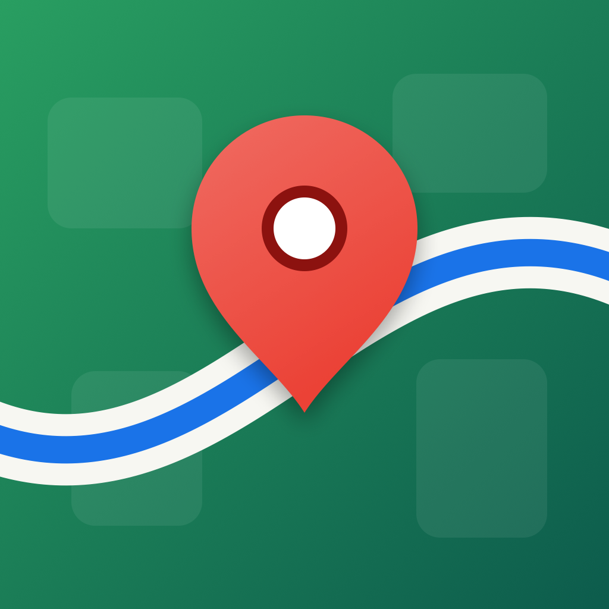
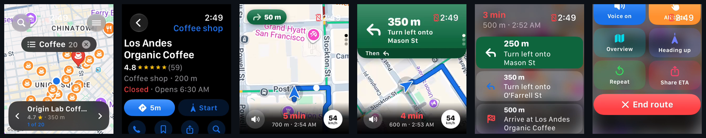

<div align="center">



# Wayfinder: Google Maps for Apple Watch

**An open-source, standalone Google Maps app for Apple Watch (watchOS 26+).**
It has real Google map tiles, Google search and place details, Google directions with live traffic, and turn-by-turn navigation with voice and wrist taps.
No iPhone app or API key needed.

[](#requirements)
[](#how-it-works)
[](#install-on-your-apple-watch-with-xcode)
[](#how-it-works)
[](LICENSE)
[](https://github.com/GagnDeep/google-maps-for-apple-watch/stargazers)


[▶ Full-quality demo video (MP4)](docs/demo.mp4) · [Install guide](#install-on-your-apple-watch-with-xcode) · [Features](#features) · [FAQ](#faq)

</div>



> **Unofficial.** Wayfinder is an independent hobby project. It is **not affiliated with, endorsed by, or sponsored by Google**.
> "Google" and "Google Maps" are trademarks of Google LLC. Map data and imagery © Google. See the [disclaimer](#disclaimer).

---

## Why?

Google Maps on Apple Watch is limited: it relies on the iPhone app and has no real map you can explore on the wrist. Apple Maps isn't detailed or accurate everywhere.
Wayfinder brings the **Google Maps experience from Android** to the wrist as a **native SwiftUI watchOS app**:

- Google's own maps, places, ratings, opening hours and traffic-aware routes.
- Built around the watch itself: Digital Crown, haptics, glanceable cards, and pages you scroll with the Crown.

## Features

### 🗺️ Map
- **Google map tiles** in Standard, Satellite, Hybrid and Terrain styles, plus a dark map.
- Layers for **live traffic**, **transit** and **biking**.
- **Digital Crown zoom**, drag to pan, and double-tap to zoom.
- Heading-up compass mode with a blue-dot puck and heading cone.
- **Touch and hold to drop a pin.** "What's here?" shows the address and Plus Code.
- Tiles are cached on disk (120 MB), so places you've already browsed keep rendering offline.

### 🔎 Search & places
- **Google search** with as-you-type autocomplete.
- One-tap categories: restaurants, coffee, petrol, ATMs, pharmacies, parking, EV charging and more.
- **Browse results on the map:**
  - A result card with ◀ ▶ shows "2 of 20" and flies the map to each place.
  - Tap a pin to select it, and tap again to open it.
- **Results list** with one-tap sorting: Relevance, Nearest, Top rated, Open now. Swipe a row for directions.
- **Place pages:**
  - Rating, review count, price level, category, and open/closed with closing time.
  - Weekly hours, review snippets, phone (tap to call), website, Plus Code, share link and mini map.
- **Saved lists:** Favourites, Want to go, Starred, Travel plans, plus **Home** and **Work** labels.

### 🧭 Directions
- **Google directions** for driving, two-wheeler (in regions where Google offers it), walking and cycling, with **live-traffic ETAs** for every mode.
- Alternative routes, shown as cards colour-coded by traffic ("Fastest route now due to traffic conditions").
- Route options: avoid highways, tolls or ferries.
- Transit ETAs come from Apple Maps (see [How it works](#how-it-works)).
- Start, Steps and **Preview drive** (a simulated drive along the route) appear right under the travel modes.

### 🚗 Turn-by-turn navigation, designed for the wrist
- **Collapsed turn chip by default.** A small green "↱ 40 m" chip sits in the corner and keeps the map clear.
  - Tap it to expand into the full Google-style green card with the street name and "Then…".
  - Tap again to collapse it.
- **Three pages on the Digital Crown:** map → upcoming steps → big-button controls.
- **Voice guidance with three modes:** Voice on / Alerts only / Muted.
  - Switch with **one tap** from the navigation screen.
  - Your choice is remembered across launches.
- **Haptics you can tell apart without looking:**
  - Right turn = a steady run of taps.
  - Left turn = taps in pairs.
  - Each of these has its own pattern: approaching a turn, rerouting, arriving.
  - Choose All taps / Turns only / Off.
- **Automatic rerouting** through Google when you go off route.
- Speed-based zoom, heading-up or north-up, route overview, and a speedometer.
- **Keeps guiding with your wrist down** (background location session).
- **Resume after the app closes.** "Resume route to …?" picks the trip back up from where you are.
- On arrival: trip time and distance, plus **Save parking**.

### ⌚ Apple Watch extras
- **Complications / Smart Stack widgets:** Search, Home, Work, Parking, Food, Petrol.
- **Siri & Shortcuts (App Intents):**
  - "Take me home with Wayfinder"
  - "Find coffee with Wayfinder"
  - "Where did I park with Wayfinder"
  - … and more.
- **Parking:**
  - Save your spot and get walking directions back.
  - Set a **meter timer** with the Digital Crown, with a notification.
- **Timeline** of your trips, kept on the watch.
- **Compass**, **Measure distance**, **Share my location** (Plus Code + link).
- Settings: units, default travel mode (remembers your last one), voice speed, and privacy controls to clear history or the timeline.

## Requirements

| | |
|---|---|
| **Apple Watch** | Running **watchOS 26 or later**, paired with an iPhone |
| **Mac** | With **Xcode 26 or later** (free from the Mac App Store) |
| **Apple ID** | A **free Apple ID is enough**. A paid Apple Developer Program membership is optional |
| **Internet on the watch** | Through the paired iPhone, Wi-Fi or cellular. Maps, search and routing are live Google data |

## Install on your Apple Watch (with Xcode)

Wayfinder isn't on the App Store yet, so you build it yourself with Xcode. It takes about 10 minutes the first time.

### 1. Get the code

```bash
git clone https://github.com/GagnDeep/google-maps-for-apple-watch.git
cd google-maps-for-apple-watch
```

Or click **Code ▸ Download ZIP** on GitHub and unzip it.

### 2. Add your Apple ID to Xcode

Open **Xcode ▸ Settings… ▸ Accounts** and click **+ ▸ Apple ID** to sign in. Then select your account and note the **Team ID**.
With a free Apple ID, the team is called *"Your Name (Personal Team)"*.

### 3. Tell the project who you are (one small file)

Create `Config/Signing.local.xcconfig`. This file is git-ignored, so your Team ID never gets committed.

```bash
cat > Config/Signing.local.xcconfig <<'EOF'
DEVELOPMENT_TEAM = ABCDE12345
BUNDLE_ID_PREFIX = com.yourname
EOF
```

- Replace `ABCDE12345` with **your Team ID**.
- Replace `com.yourname` with anything unique to you, such as `com.janedoe`.

The app then gets the bundle ID `com.yourname.wayfinder.watchkitapp`.

> Prefer clicking? Open the project and select the **Wayfinder** target, then **Signing & Capabilities ▸ Team**.
> Pick your team there, and do the same for the **WayfinderWidgets** target.
> If Xcode says the bundle identifier is unavailable, change `BUNDLE_ID_PREFIX` in `Config/Signing.xcconfig`.

### 4. Turn on Developer Mode

- **iPhone:** **Settings ▸ Privacy & Security ▸ Developer Mode ▸ On**, then restart.
- **Apple Watch:** **Settings ▸ Privacy & Security ▸ Developer Mode ▸ On**, then restart.
  - The switch appears on the watch only after the watch has been seen by Xcode (step 5).
  - If it's missing, do step 5 first and come back.

### 5. Connect your watch to Xcode

1. Connect your **iPhone** to the Mac with a cable, or put both on the same Wi-Fi. Tap **Trust** if asked.
2. Keep the **watch unlocked, on your wrist or on its charger, near the iPhone**.
3. Open **Xcode ▸ Window ▸ Devices and Simulators**. Your Apple Watch should appear under the iPhone.
   - The first time, Xcode spends a few minutes **"Preparing"** the watch for development. Let it finish.

### 6. Build and run

1. Double-click **`Wayfinder.xcodeproj`** to open it in Xcode.
2. In the toolbar, choose the **Wayfinder** scheme and **your Apple Watch** as the run destination.
3. Press **⌘R** (Product ▸ Run).
4. With a **free Apple ID**, the watch may show *"Untrusted Developer"* the first time.
   - On the **iPhone**, open **Settings ▸ General ▸ VPN & Device Management**, tap your Apple ID, then **Trust**.
   - Then run again.
5. On first launch, allow **Location** access. Choose **Allow While Using App**, and later allow **Always** so guidance continues with your wrist down.

That's it. Wayfinder is now on your watch's app list, and you can add its complications to any watch face.

> **Free Apple ID note:** apps signed with a free account expire after **7 days**. Just press ⌘R in Xcode again to renew.
> A paid developer account extends this to a year.

### Try it in the Simulator (no watch needed)

1. Pick any **Apple Watch** simulator as the run destination and press **⌘R**. No signing setup is needed.
2. Give it a location in the Simulator app: **Features ▸ Location ▸ Custom Location…**
3. Tip: after getting directions, tap **▶ Preview drive** to watch a simulated drive with full turn-by-turn guidance.

### Command line (optional)

```bash
# Simulator
xcodebuild -project Wayfinder.xcodeproj -scheme Wayfinder \
  -destination 'platform=watchOS Simulator,name=Apple Watch Series 11 (46mm)' build

# Your watch (find its UDID with: xcrun devicectl list devices)
xcodebuild -project Wayfinder.xcodeproj -scheme Wayfinder -configuration Release \
  -destination 'id=<WATCH-UDID>' -allowProvisioningUpdates -derivedDataPath build build
xcrun devicectl device install app --device <WATCH-UDID> build/Build/Products/Release-watchos/Wayfinder.app
```

The project is generated from [`project.yml`](project.yml) with [XcodeGen](https://github.com/yonaskolb/XcodeGen).
After changing it, run `brew install xcodegen && xcodegen generate`.
The generated `Wayfinder.xcodeproj` is committed, so you don't need XcodeGen just to build.

### Troubleshooting

| Problem | Fix |
|---|---|
| *"Failed to register bundle identifier" / "not available"* | Pick a different `BUNDLE_ID_PREFIX` in `Config/Signing.local.xcconfig`. |
| *"No Account for Team" / "Signing requires a development team"* | Check `DEVELOPMENT_TEAM` (step 3), or pick a team in **Signing & Capabilities** for **both** targets. |
| Watch doesn't show up in Xcode | Unlock the watch and keep it near the iPhone. Restart the watch, iPhone and Xcode. Make sure Developer Mode is on (step 4). |
| *"Connection interrupted" / install fails halfway* | Wireless watch installs can be flaky. Wake the watch and press ⌘R again. |
| Stuck on *"Preparing Apple Watch"* | Leave the watch on its charger near the iPhone and wait. The first time can take 10+ minutes. |
| *"Untrusted Developer"* | iPhone **Settings ▸ General ▸ VPN & Device Management ▸ Trust**. |
| Blank map or no search results | The watch needs internet (iPhone nearby, Wi-Fi or cellular). Google endpoints may also have changed; please [open an issue](../../issues). |
| App disappeared after a week | Free-account apps expire after 7 days. Run from Xcode again. |

## How it works

Wayfinder is a pure **Swift / SwiftUI** watchOS app with **no third-party dependencies**.

| Piece | What it does |
|---|---|
| `Map/` | A custom **Web-Mercator raster map engine** drawn with SwiftUI `Canvas`: Google tiles, parent-tile fallback while sharp tiles load, LRU memory cache plus 120 MB disk cache, Crown zoom, fling panning, rotation, pins, route lines and the navigation chevron. |
| `Core/GoogleSearch.swift` | Google Maps search, autocomplete, place details and reverse geocoding, using the same keyless endpoints the Google Maps website uses. |
| `Core/GoogleDirections.swift` | Google Maps directions: route geometry, steps, maneuvers, traffic-aware ETAs and alternatives. |
| `Core/NavigationEngine.swift` | Snaps your GPS position to the route and times voice and haptic prompts. It also detects off-route (and reroutes), handles arrival, logs trips, and runs Preview drive. |
| `Core/Guidance.swift` | `AVSpeechSynthesizer` voice, plus distinct `WKHapticType` patterns for left and right turns. |
| `Intents/`, `WayfinderWidgets/` | App Intents (Siri & Shortcuts) and WidgetKit complications. |
| Storage | SwiftData (saved places, recents, parking, trips) and `UserDefaults` (settings). Everything stays on the watch. |

**No API key.** Wayfinder talks to Google the same way the Google Maps website does in a browser.
It does not use the paid Google Maps Platform APIs.
**Transit** directions fall back to Apple MapKit ETAs, because Google only serves transit routes to full browser sessions.

## Privacy

- **No account, analytics, tracking or servers of ours.**
- Map, search and route requests go **directly from your watch to Google**, as they would from a browser.
- Saved places, history, parking and trips are stored **only on your watch**. Settings can clear them.

## FAQ

**Is there an official Google Maps app for Apple Watch?**
Google's Apple Watch support comes with the iPhone app and is limited (navigation is driven from the phone). Wayfinder is an unofficial, open-source alternative that runs **fully on the watch**, with its own map, search and routing.

**Do I need a Google Maps API key?**
No. Nothing to configure and nothing to pay for.

**Does it work without the iPhone nearby?**
Yes, if the watch has its own internet connection (Wi-Fi or a cellular model). Places you've already viewed also render from the tile cache.

**Does it work offline?**
Partly. Previously viewed map areas are cached, but search and routing need a connection.

**Will this be on the App Store?**
Not currently. Use the [Xcode install guide](#install-on-your-apple-watch-with-xcode).

**Which watches are supported?**
Any Apple Watch that runs **watchOS 26+**. It's tested on Apple Watch SE 3 and Series 11 (simulator).

## Roadmap

- [ ] Google transit directions on the watch
- [ ] Downloadable offline areas
- [ ] Place photos
- [ ] Lane guidance and speed limits
- [ ] Companion iPhone app for sending routes to the watch
- [ ] Localization

Ideas and pull requests are very welcome. See [CONTRIBUTING.md](CONTRIBUTING.md).

## Disclaimer

Wayfinder is an **unofficial** project made for personal and educational use.
It is not affiliated with, endorsed by, or connected to Google LLC or Apple Inc.
It uses publicly reachable Google Maps web endpoints that are **not a documented or supported API**.
They may change, rate-limit or stop working at any time.
You are responsible for making sure your use complies with [Google's Terms of Service](https://policies.google.com/terms) and the [Google Maps Terms](https://maps.google.com/help/terms_maps/).
Map data and imagery © Google. Do not use for safety-critical navigation; always follow road signs and local laws.

## License

[MIT](LICENSE): do what you like, no warranty.

---

<div align="center">

If Wayfinder is useful to you, **please ⭐ star the repo**. It helps other Apple Watch owners find it.

<sub>Keywords: Google Maps Apple Watch · Google Maps watchOS · Apple Watch navigation app · turn-by-turn Apple Watch · watchOS maps SwiftUI · open-source Apple Watch app · Google Maps without API key</sub>

</div>
